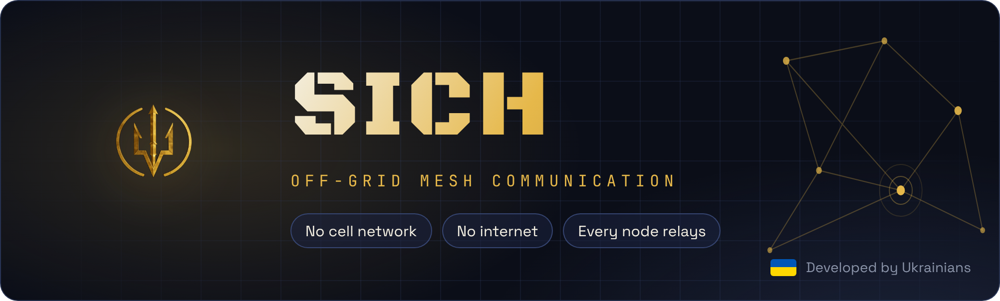

  

**SICH** is an off-grid communication device. It lets people send messages over a long-range LoRa mesh — no mobile network, no internet, no infrastructure. Short voice messages are in development.

Devices can relay messages for each other, so the network keeps working when cell towers and internet links go down. SICH grew out of what happened in Ukraine: when infrastructure fails, people still need to reach each other.

---

SICH™ is a trademark of BFU Electronics LTD. SICH software is released under open-source licenses, see each repository for details. No warranty is provided, use at your own risk.
